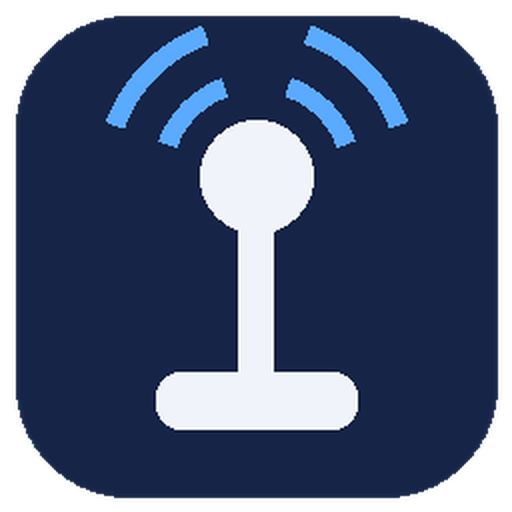
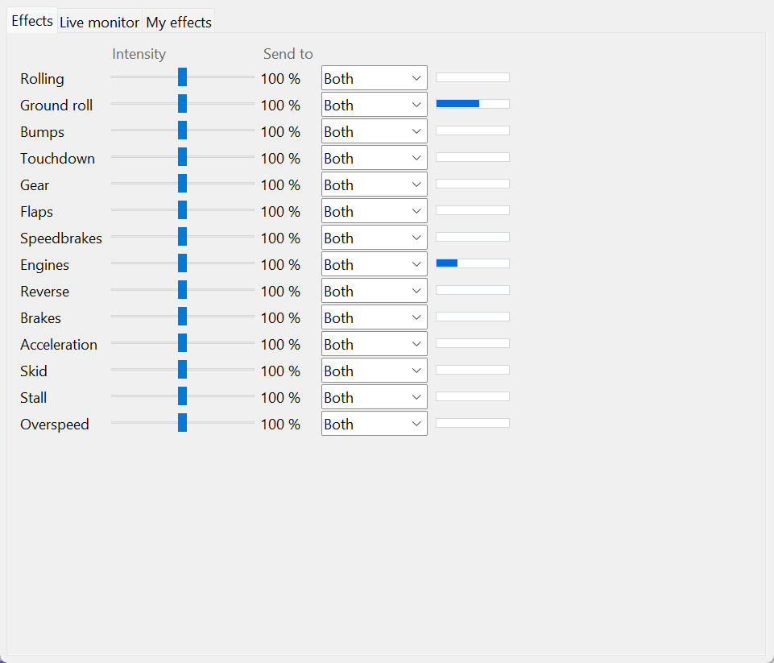
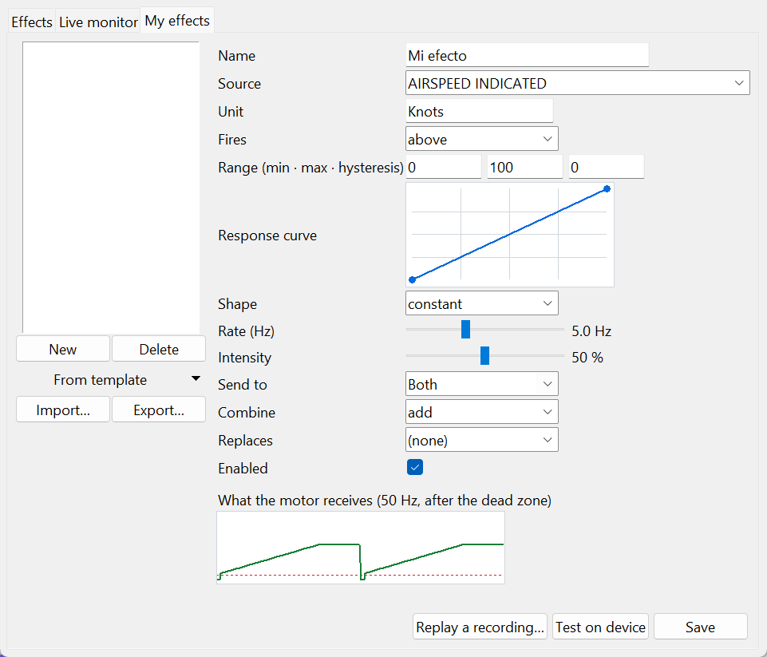

<div align="center">


# ✈️ Groundfeel
### Realistic ground & flight vibration for WinWing sticks and throttles

[](LICENSE)


[](../../releases/latest)
[](../../releases)

*Tactile feedback for the **WinWing URSA MINOR 32** joystick and throttle in **Microsoft Flight Simulator 2024**,
computed from what your aircraft is really doing.*

**English** · [Español](README.es.md) · 📖 [User guide](docs/USER_GUIDE.md) · [Changelog](CHANGELOG.md)

🚀 **Quick start:** [English](docs/quickstart/en.md) · [Español](docs/quickstart/es.md) · [中文](docs/quickstart/zh.md) · [हिन्दी](docs/quickstart/hi.md) · [Français](docs/quickstart/fr.md) · [العربية](docs/quickstart/ar.md) · [বাংলা](docs/quickstart/bn.md) · [Português](docs/quickstart/pt.md) · [Русский](docs/quickstart/ru.md) · [اردو](docs/quickstart/ur.md) · [Bahasa Indonesia](docs/quickstart/id.md) · [Deutsch](docs/quickstart/de.md) · [日本語](docs/quickstart/ja.md) · [मराठी](docs/quickstart/mr.md) · [తెలుగు](docs/quickstart/te.md) · [Türkçe](docs/quickstart/tr.md) · [தமிழ்](docs/quickstart/ta.md) · [Tiếng Việt](docs/quickstart/vi.md) · [한국어](docs/quickstart/ko.md) · [Italiano](docs/quickstart/it.md)

</div>

---

## 🌟 Overview

Groundfeel replaces SimAppPro's vibration with effects computed from the aircraft's real state: a physical ground-roll
model that knows asphalt from grass and a Cessna from an A350, wheel brakes with anti-skid, reverse thrust, touchdown
and nose-gear contact, engine start and spool, gear, flaps and slats, speedbrakes, overspeed and stall buffet. It runs
in the system tray, updates itself, speaks 20 languages, and lets you build your own effects.



Every built-in effect has its own intensity and can be sent to the joystick, the throttle, both or neither. The bar on
the right shows it live.

*Formerly "URSA Rumble". Independent project, not affiliated with WinWing or Microsoft.*

| Simulator | Transport | Notes |
|---|---|---|
| Microsoft Flight Simulator 2024 | SimConnect | Any aircraft; per-aircraft profiles and L:Vars |
| Microsoft Flight Simulator 2020 | SimConnect | Untested — reports welcome |

| Hardware | Status |
|---|---|
| WinWing URSA MINOR 32 Joystick L | ✅ Verified |
| WinWing URSA MINOR 32 Throttle Metal R | ✅ Verified |
| Other WinWing / WINCTRL models | Planned for a later version |

## 📥 Download & Install

1. Download `VibracionURSA-Setup.exe` from the [latest release](../../releases/latest).
2. Run it. It's a standard installer (Inno Setup) that installs for your user only, without admin rights, in
   `%LOCALAPPDATA%\Programs\VibracionURSA`, with a Start menu entry and an uninstaller.
3. **Turn off SimAppPro's vibration** for the joystick and the throttle, so the two programs don't fight over the motors.

> Until the builds are code-signed (see [Code signing policy](#code-signing-policy)), Windows SmartScreen may warn
> that the publisher is unknown: click "More info → Run anyway". Each release is built by GitHub Actions from this
> repository's source; the SHA-256 of every file is shown on the release page.

### First run

Groundfeel lives in the **system tray**, next to the clock, and **starts with Windows** (an installer option you can
untick). It connects by itself when the simulator opens. Right-click the icon → **Settings** shows whether the
simulator and the devices are connected and which effects are vibrating; **Effects…** opens the effect cards, the live
monitor and the editor.

### Updating

Updates are automatic. The app checks GitHub a few seconds after it starts and then every 6 hours. When the simulator
is closed — never mid-flight — it downloads the new installer only from this repository's releases, requires the
SHA-256 published by GitHub to match (if it is missing or different, it does not update), runs it silently and tells
you when it's done. You can also use "Check for updates", or turn automatic checks off in Settings. Your settings are
kept.

**Uninstall:** tray menu → "Uninstall…", or Windows "Installed apps". Your settings stay in `%APPDATA%\VibracionURSA`.

## 🚀 Key Features

### 1. 🛬 Ground physics by surface and weight
- An ISO 8608 runway profile plus slab joints feeds a two-mass nose-gear model, integrated every 2.5 ms and scaled by
  the aircraft's **real weight**. Grass, gravel and dirt shake far more than asphalt; a Cessna rattles quicker and
  drier than an A350.
- **Touchdown** strength follows the descent rate, then the **nose gear** lands with its own, softer bump. For 0.8 s
  everything else goes quiet so the touchdown is never masked.

### 2. 🛑 Brakes, anti-skid, reverse and skid
- An initial jolt, a wheel tremor that slows down with the wheels, anti-skid pulses and a small bump when you stop.
- **Reverse thrust** on each engine's lever — inferred from N1 and deceleration on aircraft that don't publish it
  (FlyByWire A32NX).
- A rough vibration when the tires slide sideways.

### 3. ✈️ Flight events
- **Landing gear:** a bump when it unlocks and a "clunk" with a small rebound when it locks — nothing while it travels.
- **Flaps and slats:** both count as movement, so aircraft whose slats move alone are covered.
- **Speedbrakes:** only when both sides are deployed, so roll spoilers in a turn never trigger them.
- **Overspeed:** grows with how far you are above the aircraft's maximum speed (barber pole).
- **Stall buffet** that builds up with angle of attack, before the warning horn.
- **Turbulence:** real vertical jolts, on the joystick only.

### 4. 🔥 Engines, lever by lever
- Each throttle lever follows its own engine. 1 engine: both levers; 3: the center one on both; 4: engines 1-2 on the
  left lever and 3-4 on the right.
- **Staged engine start:** starter ramp (cranking pulses on piston engines), an ignition kick, acceleration to idle,
  and a smooth fade if the start is aborted. Then a hum that grows with power — N1 on jets, RPM on pistons and
  turboprops.

### 5. 🧩 Aircraft profiles and L:Vars
- Profiles (`perfiles/*.json`) apply automatically by aircraft name and can read the aircraft's own **L:Vars**: declare
  them in `"lvars"` and choose which standard variable each one replaces in `"fuentes"`. An L:Var the aircraft doesn't
  have reads 0 and the standard variable is used.
- **Record flight** (tray menu or Settings) saves the simulator data to `%APPDATA%\VibracionURSA\grabaciones\` to tune
  profiles with real flights.

### 6. 🛠️ Build your own effects


- **Any variable:** pick a simulator variable or type an L:Var and its unit.
- **When it fires:** always, above, below, between, on/off, or while the value is changing — with hysteresis.
- **Response curve** you draw with the mouse (click to add a point, drag, right-click to remove), and a **shape**:
  constant, pulse, thump, sine or sawtooth, up to 12.5 Hz.
- **See what the motor really gets:** the preview runs the same engine as the live loop — 50 Hz, dead zone, pulsing
  below it and the start kick — not an ideal curve.
- **Test on device** plays it on your hardware for 5 s; **Replay a recording** runs one of your recorded flights
  through it.
- Start from a template (Impact, Hum, Pulsation, Growing), send it to the joystick, the throttle or both, add it or
  take the maximum, and optionally **replace** a built-in effect. Effects are shared as plain JSON.

### 7. 📈 Live monitor
- The output of each motor over the last 10 seconds and every simulator variable the app is reading, live.
- The loop runs at a fixed 50 Hz with a 1 ms Windows timer, and logs its real cadence (p50 / p99 / max) every minute.

### 8. 🌍 20 languages · 🔒 privacy
- English, Mandarin Chinese, Hindi, Spanish, French, Arabic, Bengali, Portuguese, Russian, Urdu, Indonesian, German,
  Japanese, Marathi, Telugu, Turkish, Tamil, Vietnamese, Korean and Italian. It follows Windows; change it in Settings.
- **No telemetry.** "Report a problem" opens a pre-filled GitHub issue with your user folder, user name and computer
  name masked; you review it and decide whether to send it.

## 🎮 Effects in detail

| Effect | What you feel | Where |
|---|---|---|
| Ground roll | Physical model by surface, speed and weight. | Joystick |
| Rolling | Joint bumps and a rumble that grow with speed. | Throttle |
| Touchdown | A bump by descent rate, then the nose gear. | Both |
| Wheel brakes | Jolt, wheel tremor, anti-skid pulses, stop bump. | Both |
| Engines | Staged start, idle minimum, hum with power, per lever. | Throttle |
| Spool / acceleration | A push when power goes up, then the real acceleration. | Both |
| Reverse | Strong vibration on each engine's lever. | Throttle |
| Skid | Rough vibration when the tires slide sideways. | Both |
| Gear, flaps/slats, speedbrakes, stall, overspeed | According to their state. | Both |
| Turbulence | Real vertical jolts in flight. | Joystick |

By default the joystick vibrates **on the ground only**; untick it in Settings to feel flight effects in the stick
too. Everything can be re-routed in **Effects…**.

### Advanced settings

`config.json` holds the defaults (it ships with every version: don't edit it). Your changes go in `ajustes.json`, in
`%APPDATA%\VibracionURSA` (Settings → "Settings folder"), with the same structure — for example
`{"frenos": {"antibloqueo": 0.5}}`. They apply on save, without restarting. Main keys: `ganancia_general`,
`zona_muerta`, `mezcla`, `ruteo`, `intensidad_efecto`, `efectos_propios`, `rodaje_fisico` and one block per effect.

## 🛠️ System requirements & building

- Windows 10/11, MSFS 2024, WinWing URSA MINOR 32 joystick L and/or throttle Metal R.

```
instalar.bat                            (once: Python environment and dependencies)
venv\Scripts\python.exe bandeja.py      (tray app from source)
venv\Scripts\python.exe pruebas.py      (tests, no simulator or hardware needed)
venv\Scripts\pyinstaller VibracionURSA.spec
ISCC /DVersion=1.7.0 instalador.iss     (needs Inno Setup 6)
```

How it works: `sim_lector.py` (SimConnect, read-only) → `efectos.py` + `rodaje_fisico.py` + `efectos_propios.py`
→ `motores.py` (HID, report `0x02` + `[part LE, 00, 00, 03, 49, index, value]`), driven by `motor_vibracion.py` at
50 Hz. Releases: bump `version.py`, push a `vX.Y.Z` tag; GitHub Actions tests, builds and publishes.
`recursos/SimConnect.dll` is the redistributable client library from Microsoft's MSFS 2024 SDK.

**Troubleshooting:** Settings shows the simulator connection and the devices found; "View log" has the details. If a
motor keeps vibrating after the app was killed abruptly, open it again: it turns the motors off when it starts.

## 📌 Acknowledgments

- The motors' HID protocol is based on [ursa-minor-ffb](https://github.com/rtroncoso/ursa-minor-ffb) by rtroncoso (MIT).
- Ideas for the flight events (spoiler symmetry, slats, overspeed against the barber pole, per-gear touchdown, staged
  engine start) and the effect editor were inspired by [Aurora Vibra](https://github.com/chegevarko1982/aurora-vibra)
  (MIT) — a great choice if you fly X-Plane or War Thunder.

## Code signing policy

> **Status: pending.** Builds are not code-signed yet; the application to SignPath Foundation has not been approved.
> This section describes the policy that will apply once it is.

Free code signing provided by [SignPath.io](https://about.signpath.io/), certificate by
[SignPath Foundation](https://signpath.org/). Committers, reviewers and approvers:
[agustin320](https://github.com/agustin320). Only binaries built by GitHub Actions from this repository's source are
signed, and every signing request is approved manually.

### Privacy

No personal data is sent and there is no telemetry. The only network connection is to GitHub (`api.github.com` and
release downloads) to check for and download updates — a few seconds after start and every 6 hours — and it can be
turned off in Settings. Like any web request, GitHub receives your IP address and the app version; GitHub's
[privacy statement](https://docs.github.com/site-policy/privacy-policies/github-general-privacy-statement) applies.
The program reads the simulator through SimConnect and writes only to the WinWing vibration motors. "Start with
Windows" adds a value under `HKCU\Software\Microsoft\Windows\CurrentVersion\Run`, which the uninstaller removes.
Third-party licenses: `THIRD-PARTY-NOTICES.txt`.

## 📜 License

MIT. See [LICENSE](LICENSE).
